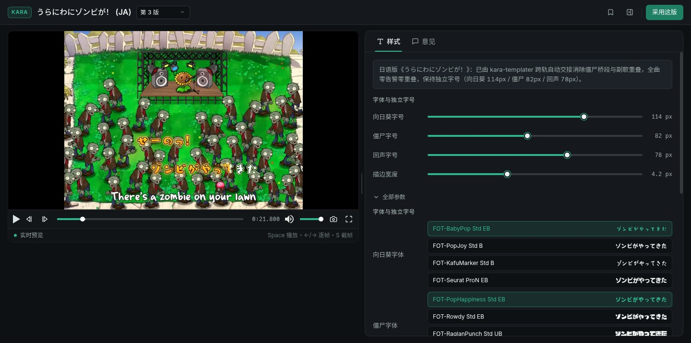
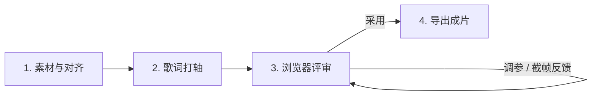

<div align="center">


### 交给 AI Agent，端到端制作卡拉 OK 特效字幕视频

从素材对齐、多声部打轴、浏览器调参评审到 1080p60 原唱 / 伴奏成片导出。

[核心功能](#核心功能) · [快速开始](#快速开始) · [工作流与组件](#工作流与组件) · [For AI Agents](#for-ai-agents)

</div>

---

## 核心功能

- **自动对齐音画**：核对原唱、伴奏、歌词与画面是否属于同一录音版本并校准起点；缺伴奏或需人声轨时自动分离。
- **多声部精准打轴**：支持主唱、和声、多角色分轨与日语汉字注音，输出可随时手工微调的工程文件。
- **浏览器实时评审**：边听原曲边逐帧核对，实时调整字号、字体、配色与动效，或直接截帧框选画面问题交给 Agent 修订；拿不准风格时可选开启多方案比选与特效组件库自助组合。
- **GPU 高速渲染交付**：支持渐变扫色、导唱符、粒子与自定义着色器特效，预览与成片所见即所得，一键输出 1080p60 原唱与伴奏视频。

<div align="center">
  
  <br />
  <sub>浏览器实时评审界面：边听边调字号、字体与配色，支持逐帧定位与截帧反馈</sub>
</div>

---

## 快速开始

### 1. 安装

把下面这段话发给你的 AI Agent，也可以按[安装向导](INSTALL.md)手动安装。

```text
请按 https://github.com/sitiyou/vibekara/blob/main/INSTALL.md 安装 vibekara，
复用本机已有工具，并为当前 Agent 注册 Skill。完成后告诉我安装结果。
```

### 2. 开始制作

只要给 Agent **一条能找到目标录音的线索**（本地音频、歌曲目录、MV 链接或歌名/版本），说明想要的输出即可（详见 [输入格式](docs/media.md#可以提供什么)）：

- **从零制作**：`用这个 MV 做一版原唱卡拉 OK，歌词帮我找，画面就用 MV，再出一版 off vocal。`
- **多声部 / 定制特效**：`音频和伴奏在这里，出双语 on/off vocal；打轴分好不同角色和声轨，特效按画面风格做细节设计。`
- **续修旧工程**：`打开 ./my-song/ 目录，把副歌和声补齐后给我浏览器预览。`

---

## 工作流与组件



| 阶段 | 做什么 | 工具 / 文档 |
| --- | --- | --- |
| **1. 素材与对齐** | 核对录音版本、校准音画起点、按需分离人声与伴奏 | `PyMSS` · [媒体准备](docs/media.md) |
| **2. 歌词打轴** | 节拍对齐、读音与分轨标注，保存可编辑工程（`.nto`） | [Namioto](https://github.com/sitiyou/namioto) |
| **3. 样式评审** | 浏览器实时试放与调参，支持可选多方向比选与组件库编辑 | [kara-previwer](kara-previwer/README.md) · [首轮评审](docs/first-review.md) |
| **4. 导出成片** | 编译独立着色器并渲染 1080p60 原唱 / 伴奏视频 | [kara-templater](https://github.com/sitiyou/python-kara-templater) · [投稿指南](docs/publishing.md) |

每首歌曲目录都会自动维护进度记录，随时可从任意阶段续作；本机素材库、字体习惯与模板收藏可保存在 [本地偏好](docs/preferences.md)。

<details>
<summary><b>进阶：从 Python 直接导出</b></summary>

在仓库根目录可直接把打好轴的 `.nto` 导出为字幕着色器：

```sh
~/.vibekara/.venv/bin/python skills/vibekara-export/assets/render_hook.py song.nto lyrics.hook
```

需要自定义样式时，将 `skills/vibekara-export/assets` 加入 `sys.path` 后调用 [`load_nto()`](skills/vibekara-export/assets/import_nto.py)：

```python
from kara_templater import KaraokeEffects, Style, Track, build_lyric_scene
from import_nto import load_nto

document = load_nto(
    "song.nto",
    harmony_tracks="1",
    styles=(Style(name="default", fontname="sans-serif", fontsize=96),),
)
scene = build_lyric_scene(
    document,
    tracks=(Track(id="lyrics", effects=(KaraokeEffects(),)),),
)
scene.export("lyrics.hook")
```

</details>

---

## For AI Agents

整曲制作或续作先读 [vibekara 总流程](skills/vibekara/SKILL.md)，单阶段任务直接进入对应入口：

| 任务 | Skill 入口 |
| --- | --- |
| 整曲编排、续作与进度记录 | [skills/vibekara/SKILL.md](skills/vibekara/SKILL.md) |
| 素材查找、版本核对与音画对齐 | [skills/vibekara-assets/SKILL.md](skills/vibekara-assets/SKILL.md) |
| 歌词、读音、多声部打轴 | `deps/namioto/skills/namioto-nicokara/SKILL.md` |
| 字幕排版、粒子与着色器模板 | `deps/kara-templater/skills/kara-templater/SKILL.md` |
| 浏览器评审、反馈修订与快照 | [skills/kara-previwer/SKILL.md](skills/kara-previwer/SKILL.md) |
| 整曲构建与视频合成 | [skills/vibekara-export/SKILL.md](skills/vibekara-export/SKILL.md) |

评审脚本与事件协议见 [kara-previwer/README.md](kara-previwer/README.md#for-ai-agents)。
